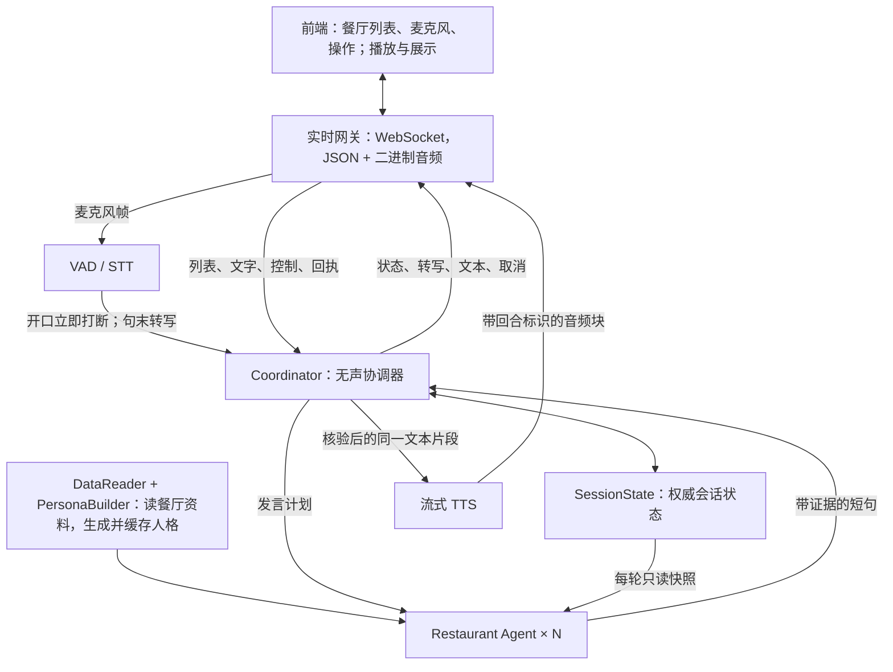

# Multi-Agent 实时语音接口与内部设计 v2

2026-10-17。本文件是本轮统一设计，替代此前“仅文本输出、STT/TTS在外部、餐厅只拿少量历史”的约定。已有独立的[调试控制台](../CONSOLE.md)实现WebSocket文本/音频、取消、后端转写和过程检查；具体能力边界见该说明。既有LiveKit演示保持原样。

## 1. 最终边界

**输入：前端给出的餐厅列表、持续麦克风音频、文字和控制信号。后端：读资料、生成餐厅人格、VAD/STT、Multi-Agent讨论、TTS。输出：同一会话中的转写、每轮一次完整文本结构化结果、流式音频、状态与取消。**

前端决定参选集合，restaurantId使用双方约定的业务ID（当前数据为shop_uuid）。后端按列表读取，不自行发现或补位。前端负责采音、播放和展示，不必做转写、人格生成或重复合成TTS。表演层使用本服务返回的音频，避免再次配音。

Agent仍只有Coordinator与Restaurant Agent × N。资料读取、人格构建、VAD/STT/TTS、连接管理和状态存储都是普通组件，不增加会说话的Agent。

调度的evidenceIds允许比较时引用其他参选餐厅的资料，建议选择1–4条但不设硬上限；忽略未知、已移除或当前不可读的引用，并去重，有效引用必须来自本次availableAgents.evidence。各店提供本轮新资料、基础资料及已听历史引用的原始证据，并以freshEvidenceIds区分新资料。证据过滤后若依据不足，在同一上下文中让LLM重选一次；仍失败则明确记录coordinator.evidence_recovered，使用当前可读餐厅的真实资料继续，由餐厅LLM生成。其他名单/结构错误仍单独处理。

2026-10-17调试实现更新：Coordinator的下一轮发言规划已接入LLM，读取会话状态、用户问题与各店可用证据，选择说话人、回应对象、引用、行为类别并流式输出结构化决策。模型提案须通过后端ID、证据归属、replyTo播放状态与结构校验才能执行；模型请求失败或非法结果会暂停。名单/偏好变更、取消、证据检查和当前推荐仍由代码处理，不表示所有组件都已模型化。调试HTML通过workflow事件显示各组件状态、完整实际提示词、输入和公开输出增量，可固定查看任一执行步骤。



## 2. 传输与前端输入

主接口建议为一个 `WS /api/realtime`，使用wss部署、localhost可用ws。JSON消息承载命令/元数据，binary消息承载PCM，不使用base64包装音频。WebSocket只是传输；实时打断还依赖VAD、任务取消、短队列和前端清空播放缓冲，不能仅靠长连接保证时延。

JSON输入统一 `{sessionId, commandId, type, data}`；commandId去重。前端输入：

| 信号 | 内容 | 处理 |
|---|---|---|
| session.start | restaurantIds、初始需求/preferences、audio输入参数 | 加载资料和人格，返回ready及协商音频格式 |
| binary mic frame | streamId、chunkSeq、sampleOffset + PCM字节 | 持续送VAD/STT，不等用户录完一个文件 |
| restaurants.update | 更新后的完整restaurantIds | 原子换名单，停止旧回合，保留偏好，加载新店 |
| user.text | 用户文字、可选focusRestaurantId | 与最终转写进入同一意图处理路径 |
| control | action=pause/resume/interrupt/reset/recommend | 控制讨论，不需要等STT |
| playback | turnId、epoch、status、playedSamples | 报告真实播放进度/结束/取消/失败 |

初始格式建议：麦克风PCM s16le、mono、16000Hz，每帧20ms即320样本；TTS输出PCM s16le、mono、24000Hz，每帧20ms即480样本。真实格式以ready/音频start协商为准。浏览器实际采样常为其他频率，采集适配器需真正重采样，不能只改sampleRate字段。不得将WebM/Opus压缩块当作PCM解码。

开始会话后先等ready，再上传音频。PCM无WAV文件头；前端用流式播放器缓冲并播放，不逐块当成完整音频文件。会话不因本轮回答停止接收麦克风，确保播放中也能检测用户开口。

二进制帧格式统一为 `[uint32小端JSON头长度][UTF-8 JSON头][PCM字节]`。每个WebSocket binary消息是一帧，不依赖相邻JSON消息提供标识。输入头为kind=mic、streamId、chunkSeq、sampleOffset；输出头为kind=tts、epoch、turnId、segmentId、chunkSeq、sampleOffset。采样率和声道来自所属stream的start元数据，sampleOffset为该流/回合内的样本位置。麦克风stream与回复epoch独立，打断回复不能丢掉用户随后继续说的话。

服务端限制帧长，使用有界发送队列、小音频块；控制/取消优先，过期输出清出队列。WebSocket已有发送缓冲不能靠服务端撤回，必须由前端按epoch/turnId拒收并清理已排队声音。慢消费时暂停/限制生成，不能无限堆积音频。

## 3. 后端输出：文本与音频同属一个回合

JSON输出外层 `{sessionId, seq, epoch, type, data}`。seq在会话内递增；epoch用于取消代次；turnId唯一标记一轮餐厅发言；segmentId关联一段文本与对应TTS。二进制音频自带epoch/turnId/segmentId及音频chunkSeq，不与JSON seq混用。

| type | 内容 |
|---|---|
| state | ready/running/listening/paused/waiting/finished、当前餐厅、偏好、列表、当前turn、revision、音频协商参数 |
| transcript | utteranceId、phase=partial/final、用户识别文本；只在final后提交偏好与命令 |
| turn | phase=start/generated/cancel、turnId、restaurantId、speaker、topic、speechAct、targetRestaurantId、replyTo |
| text | 仅phase=done，每轮成功产出一次：turnId、speakerId、speaker、targetIds、replyTo、完整text、segments及去重evidence；无文本delta |
| audio | phase=start/end、turnId、格式；具体PCM由binary帧返回 |
| result | 推荐restaurantId或null、理由及证据、限制事项 |
| error | 具体code/message/recoverable |

partial转写是可选能力，当前faster-whisper适配器是句末转写，不能声称已有实时partial。VAD开口信号独立于转写，即使只支持final，也必须先打断再识别。

示例：

```json
{
  "sessionId":"s1",
  "seq":8,
  "epoch":2,
  "type":"text",
  "data":{
    "phase":"done",
    "turnId":"t3",
    "speakerId":"l1Ef2WUv8UWCV785",
    "speaker":"张江海科雅乐轩聚聚乐店主",
    "targetIds":[],
    "replyTo":[],
    "text":"我家资料中的参考人均是135元。",
    "segments":[{"segmentId":"t3-s0","text":"我家资料中的参考人均是135元。","evidenceIds":["shop:l1Ef2WUv8UWCV785:avg_price"],"audio":{"sampleStart":0,"sampleEnd":96000,"sampleRate":24000}}],
    "evidence":[{"id":"shop:l1Ef2WUv8UWCV785:avg_price","quote":"135"}]
  }
}
```

关联的音频binary头示例：

```json
{
  "kind":"tts",
  "epoch":2,
  "turnId":"t3",
  "segmentId":"t3-s0",
  "speakerId":"l1Ef2WUv8UWCV785",
  "chunkSeq":0,
  "sampleOffset":0
}
```

音频先持续返回；本轮所有音频发送完成（audio.end）后，才发送一次完整text.done，再发送turn.generated。最终文本无需等前端实际播放结束；播放状态仍由回执单独确认。segments[].audio的sampleStart含起点、sampleEnd不含终点，均为该turn内样本位置；未启用音频时为null。前端通过epoch/turnId/segmentId将最终结构化结果与已经收到或缓存的音频关联。这样正式字幕在本轮结束时一次显示，不提供实时逐句字幕；调试workflow/trace仍可观察中间生成。若在最终数据发出前被打断，本轮不发送text.done。

TTS只消费已经核验、已经确定的短句，不对未完成token反复合成。若后端做方言改写，先确定spokenText并核验关键事实，再用同一spokenText生成音频和对应字幕，可另带sourceText。前端不再二次改写/配音。

text.done=本轮完整结构化文本结果；audio.end=音频生成发送结束；turn.generated=本轮文字/音频产出完成；playback.ended=前端实际播放结束。持续讨论在当前首帧音频发送时开始预调度与生成/核验下一轮，最多提前一轮；播放结束仅控制下一轮正式交付，不再控制下一轮何时开始思考。epoch/revision/前置播放回合全部匹配才采用，用户开口或输入后整批废弃。单轮调试不预生成。

playback输入包括turnId、该音频的epoch、status=progress/ended/interrupted/failed、playedSamples。前端每100ms按实际音频输出时钟计算位置，不能报告接收长度。历史只提交播完的小分句，打断的当前小分句缺少字级时间戳时仅记录partialAudio，不按比例猜文字。旧epoch最后停止回执可以补充旧回合的已听前缀，不能触发新回合提交。新输入最多等待400ms停止回执，超时保守使用最近确认边界。

预生成上下文将speculative=true和pendingPlayback与recentDialogue分开，前者明确是可能完整播出的待播放假设；后者只含已确认文本和已听部分的引用。预生成结果不会加入历史、不会提前发正式文本/音频。当前回合未完整播放时，所有基于其全文预生成的下一轮均作废。

## 4. 组件怎样设计

| 组件 | 职责 | 状态权限 |
|---|---|---|
| RealtimeGateway | 接收音频/控制，发送事件/音频，队列与连接恢复 | 不做餐厅业务决策 |
| SpeechPipeline | VAD检出开口/句末、STT转写、短句TTS、重采样、流式帧封装 | 只报告语音事件，取消由Coordinator统一协调 |
| Coordinator | 处理用户意图/偏好/名单、调度回应、检查来源、推荐、取消 | SessionState唯一业务写入者 |
| Restaurant Agent × N | 读本店资料和会话状态，按发言计划生成台词 | 只读状态，提交台词/记忆提议 |
| DataReader + PersonaBuilder | 根据参选ID读取事实，生成并缓存人格提示词 | 更新资料/人格缓存，不修改用户偏好 |
| SessionState | 名单、偏好、对话、播放进度、当前任务和版本 | 只接受Coordinator的原子提交 |

这六项是代码组件，只有Coordinator与Restaurant是Agent。最小技术为Python、FastAPI WebSocket、asyncio、共享模型Provider、资料读取和会话存储；VAD/STT/TTS复用已有适配器。模型/原生语音推理不得阻塞接收控制的事件循环。

已有LiveKit链路可继续运行；本文件定义的是面向前端联调的WebSocket目标接口，不表示本轮已替换LiveKit。若最终复用LiveKit，则以音轨传媒体、数据通道包装同一语义事件，不把PCM塞进可靠JSON事件。

## 5. 餐厅 Agent 明确能读会话状态

每轮开始提供一份只读SessionView，含revision与epoch。必要时提供get_session_state()工具重新读取；不能直接拿可变数据库连接或修改共享状态。

SessionView包括：当前用户需求/偏好、当前及已移除餐厅、相关历史发言与回应关系、当前议题/未回答问题、每家已讲观点、当前发言/打断状态、哪些文本已经实际播放。还可读对手本轮授权的事实资料，避免只知道自己的店。

例：用户刚说“别讲价格，我在意安静”，Agent读到新的偏好和议题，生成时就转向环境的有来源描述，而不是继续旧预算任务。被取消的未播片段标为cancelled，不当成用户已经听过。没有精确字幕对齐时，播放进度只能保守估计已听内容，不伪造逐字已听记录。

Agent输出绑定其读取的revision/epoch；提交及每次流出前复核，版本过期则取消或重生成。餐厅能读取状态，不等于有权改名单/偏好或决定下一位发言。

## 6. 人格提示词由餐厅基本信息总结生成

初始化：restaurantId → 读基本资料 → PersonaBuilder生成角色设定 → 校验 → 按restaurantId+资料版本缓存 → 创建Restaurant Agent。新店加入或资料变化才更新人格，不每轮重复生成。

输入优先使用店名、分类、参考价位、商圈、已有明确特色；有来源的推荐菜/描述可补充。persona只规定身份、表达风格与关注角度，事实仍从资料上下文读取，避免人格里旧价格覆盖新数据。缺失信息不补造；不能从类别/店名推断真实老板的性别、年龄、口音或服务承诺。

例如一份资料为：名称“张江海科雅乐轩聚聚乐”、分类“自助餐”、参考人均135元。生成设定可以是：

```json
{
  "restaurantId":"l1Ef2WUv8UWCV785",
  "identitySummary":"代表张江海科雅乐轩聚聚乐参与本轮餐厅讨论，经营分类为自助餐。",
  "speakingStyle":["亲切","具体","简洁"],
  "discussionFocus":["解释本店用餐形式","结合用户预算比较","有依据地说明选择与限制"],
  "boundaries":["不保证库存和现时优惠","资料没有说明的内容先承认未知","不把顾客体验说成普遍保证"]
}
```

identitySummary中的身份来自资料；speakingStyle是生成的虚拟表达设定，不声称是真实店主性格。discussionFocus是关注角度，不是“菜品丰富/服务快速”等未经核验的商户事实。具体菜价、套餐和优缺点仍要在每轮检索证据。

最终餐厅system prompt由固定规则+生成的人格设定组成；每轮另传SessionView+RestaurantContext+TurnPlan。固定规则包含：先回应问题/被引用观点、只用给出的事实、允许承认不适合、短句输出并附来源、无权改用户条件和名单。

人格构建同时取名：优先data/brand_characters.json中有官方来源的品牌角色（如雪王、上校），其次复用商户名中明确的人物称呼（如蓉姐、老王），否则根据商户名生成稳定昵称并标记generated，不声称是官方IP或真实老板。角色元数据包括characterName、nameSource、nameBasis、regionalStyle、displayRestaurantName和口语化systemPrompt。取名及人格构建在餐厅入会话时完成。

2026-10-18：首轮按该店是否已经实际完成亮相切换system prompt，由模型把角色名和商户简称自然融进本轮发言，不保留固定introductionText、不额外拼接开场白。首次最多55字，后续最多40字，一轮只讲一个重点。isIntroduction=true可包含有证据的业务正文，引用照常检查；实际播放到完整包含角色名与商户简称的小分句才提交introducedRestaurantIds。预生成只作条件假设，版本失效即废弃。七家分别有独立口吻，基于湘/甬/菜系的轻地域表达不推断真人口音。评论可直接提炼为自家亮点或竞品槽点，出处只留在引用，不强制念来源，不将个别体验夸大为绝对保证。

偏好保存在SessionView.preferences：结构化条件+持续保存的userNotes，最新更正优先，query清空后仍参与每轮检索、调度、生成。Coordinator返回preferenceFocus，选择行为与精确evidenceIds；RestaurantContext只装配这些ID的原始记录，不自动追加其他经营资料。检索混合偏好相关、当前交锋和未展示的新资料，保留不同类型资料，调度再作选择。

控制台在TTS前用speech.ready展示已经核验的完整台词，并明确标音频输出/播放/打断状态；该事件不是已听回执，不污染历史。正式text事件仍在audio.end之后一次交付，含实际音频样本范围。

不将用户输入、原始评论或商户描述直接拼成有执行权限的system指令；它们是资料。PersonaBuilder输出结构化设定，经字段校验后填入固定模板。若生成人格失败，使用按店名/分类填充的简单角色模板，不阻塞会话。

## 7. 打断闭环

1. 前端持续上传麦克风；后端VAD检测开口，或前端显式发送interrupt。
2. Coordinator推进epoch，立即发turn.cancel，清空未发送音频/文本，取消当前LLM/TTS任务。先通知停播，不等待GPU推理结束；无法停止的计算结果丢弃。
3. 前端收到cancel立即停止声源、清空播放队列并归零说话动作，回传已播放样本位置。后续旧epoch/已取消turn的帧一律拒收。
4. VAD判定句末后STT返回final，更新会话状态、名单/偏好，再由餐厅Agent读取新快照继续。
5. 同一用户utterance只处理一次，按钮/本地快速检测与后端VAD触发的重复打断需合并；不能重复执行同一句移除命令。

pause同时取消当前媒体但保留状态；restaurants.update/reset也要取消旧回合。静音麦克风与暂停餐厅讨论是不同控制。断线时停止播放并暂停自动生成；恢复先发state并协商新音频stream，不重播旧缓冲。

验收不靠“已连上WebSocket”：需分别测VAD开口到cancel、前端收到cancel到真正静音、首个文本/首音频、旧音频拒收与弱网队列。网络与设备影响时延，不能把单次本机测值当成保证。

参考：[FastAPI WebSocket](https://fastapi.tiangolo.com/advanced/websockets/)、[MDN WebSocket](https://developer.mozilla.org/en-US/docs/Web/API/WebSocket)、[MDN binaryType](https://developer.mozilla.org/en-US/docs/Web/API/WebSocket/binaryType)。


2026-10-18表达与选题调整：角色就是餐厅化身，直接用我/我们/我这儿表达具体长处，不念“被夸/被评价”，不说“替某某接一句”的申请发言串词。每家首次出场仍需先简短介绍角色名和商户简称，由模型按性格组织，后续不再报身份；不固定开场句，也不每轮先复述用户需求。预算和禁忌等明确限制保留，普通喜好只是选题因素之一。Coordinator综合现场交锋、尚未展示的资料、话题历史和偏好选择任务，discussionDimension记录菜品/口味/食材/价格/环境/座位/摆盘/服务/上菜/套餐/分量/便利/综合；两轮同维度已聊清时优先换角度，有实质反驳可继续，不按机械轮换。最近话题只统计已听非空文本，预生成额外考虑pendingPlayback一次。验证脚本scripts/validate_debate.py检查多轮话题展开、短句、首轮与后续轮身份表达。


控制台每轮卡片显示调度行为、对象、话题维度；可展开查看本轮行为、对象、关联回合与资料ID分配，不含台词指导。speechAct区分present自荐、attack攻击、respond回应、compare对比、answer回答用户、clarify澄清/追问，标签直接来自调度计划。speech.ready及最终text也携带speechAct和discussionDimension，便于文本、音频、行为同轮绑定。

调度防复读：无人新提问且同维度连讲两轮时，不能再安排present式重复自荐；真实定向交锋的respond可接着反驳，模型可换角度或给出有依据的attack/compare。已说清的需求起手语可在不改身份与经营事实的前提下裁去，speech.polished保留前后文本；具体反驳中的需求引用保留。调度不再生成goal；餐厅实际发言中的数字仍须有本轮原始依据，避免拿历史数字当资料。


正式角色名单事件 restaurants.updated：首次session.start、restaurants.update、user.remove（文字/语音移除）和reset后，在角色构建完成后、下一轮发言前发送。data包括revision、reason、restaurants全量快照、addedRestaurantIds、removedRestaurantIds。每个restaurant含restaurantId（同发言speakerId）、restaurantName、displayRestaurantName、characterName、nameSource、personaVersion。前端用全量快照替换当前名单，用增删ID处理进出场动画；角色不必先开口才能显示名字，不依赖persona.ready调试事件。名单更新保留偏好、已听历史及介绍状态，非法更新不打断现有会话。控制台左侧“服务端角色名单”消费同一正式事件，点击角色查看原始回包。类型见handoff/realtime-output.ts的RestaurantsUpdatedEvent。


评论与聊天节奏更新：DataReader按原文提取reviewInsights检索线索，混合好评亮点与负面体验，优先覆盖不同维度，保留菜品/套餐与原始价格。线索不是事实核验结论，引用仍回到原文；差评文件名不代表内容一定负面。互喷抢客为主线，attack和真实respond占主线，present/compare穿插，用户问题优先answer/clarify；连续两轮攻击或比价且无新用户问题时需换节奏。角色首次先简短招呼用户再自然介绍，湘/江浙角色可有少量地域表达，外来品牌角色可以一声Hi/Hello，后续中文为主，不固定开场台词或反复夹英文。人格版本persona-v10；完整实际提示词导出在artifacts/current-agent-prompts.json。

CosyVoice安装：8771控制台改用F盘独立CosyVoice 3本机GPU服务（8772），详细目录、启动、取消行为及测试见COSYVOICE.md。当前参考音色已实测；按餐厅细调方言/外国口音尚未完成，不能把角色文本风格当作真实口音控制。


发言检查故障处理：历史里提到的数字不自动成为本轮依据。修正请求的requiredEdits明确要求删除未分配数字或改用不带金额的指代，不能擅自扩充调度分配的资料。修正仍失败时error.message展示具体原因，error.validation包含turnId、reasons、invalidNumbers与unknownEvidenceIds；控制台自动打开该原始事件。失败原稿和检查结果写入runtime/logs/console.log，日志不包含API密钥。

发散实测：scripts/validate_breadth.py重放128元未引用故障，真实LLM修正通过；当前四店无偏好连续10轮，以及约会安静偏好的三店连续8轮，再分别追问价格，报告artifacts/breadth-validation.json。统计按实际发言绑定的discussionDimension、speechAct与最终引用，不以提示词已修改代替实测。页面左侧显示实际ttsProvider与personaVersion，更新后需重新建立会话。


模拟用户输入现已纳入固定测试：`scripts/validate_user_inputs.py` 使用真实LLM与生产的 `ConsoleSession.command`，按步骤注入 `user.text`：切换服务/上菜话题、点名上校回答、预算改为50元且不能吃辣、撤销预算和辣度限制、移除上校、点名小麦追问及暂停。步骤之间保留会话和偏好；无输入时继续自动讨论。测试端只限制每步生成一轮并确认完整文本已展示，避免用直接改query代替实际输入解析。结果包含每条模拟输入、对应文本、行为、引用、偏好和剩余名单，见 `artifacts/user-input-validation.json`。

播放中输入另测：`scripts/validate_pipeline.py --user-barge-in` 在真实CosyVoice音频输出及下一轮已预生成时，直接发送“等等，人均预算改成50元，别一直聊价格，讲讲服务。”，不先按打断按钮。验证旧回合取消、预生成丢弃、迟到的旧epoch回执只更新已听历史、新一轮读取新条件；当前未播完的小分句和未播放未来回合不能进入文字历史。结果在 `artifacts/user-barge-in-validation.json`。两项均不启用实体麦克风；文字输入测试不能替代真实麦克风/VAD/STT验收。


2026-10-18 调度与表达边界（persona-v10，覆盖此前含goal的旧说明）：
- 调度LLM选择restaurantId、speechAct、targetRestaurantId、replyTo、evidenceIds、discussionDimension；topic/summary/preferenceFocus仅用于调试与分析，不进入餐厅TurnPlan。
- 已移除goal和自由文本发言指导。restaurant_directive使用字段白名单，旧goal、summary、suggestedText等即使出现也不会传入生成或修正模型。调度不定论点、起手句、句式、口吻、发言提纲或回复结论。
- 餐厅读取完整SessionView：所有保留的会话历史（不再只截最后12条）、当前状态、角色名单、用户偏好和最新userQuestion，结合调度分配的原始资料自主组织内容。历史只包含确认已听的小分句，预生成pending仍单独标记假设，未播全文不进入正式历史。完整会话不等于全商户资料，新增经营事实仍限本轮分配evidence。
- 每家个性化systemPrompt同时写入角色节奏、句式习惯、措辞禁忌、进攻表达和接招习惯，主要由各自人格控制表达差异。公共校验仅挡自我检讨和明显共用让步套句，不负责生成个性。不许承认失误/整改式自我检讨，也不许编造否认或补救事实。
- 首次仍招呼并介绍身份，由餐厅自主措辞，之后不重复介绍。没有统一开场、固定introductionText或轮流报菜单。
- 控制台可在「人格」查看各店systemPrompt，「Agent 输入」查看完整实际输入，在回合卡展开查看精简调度分配。公共最终文本/音频绑定协议不变。


persona-v10验收：81项单元测试通过；scripts/validate_speech_mix.py真实LLM连续12轮自动讨论（attack=4、respond=5、compare=2、present=1），再加入停车点名提问、要求澄清忌口、更正辣度/预算等3条模拟user.text，共15轮通过。测试检查生成及修正请求均不含goal/summary/topic/suggestedText，偏好与完整上下文仍传入；各店首次/后续提示词及行为输出可在控制台查看。报告artifacts/speech-mix-validation.json。行为分布是这次实测结果，不是固定轮转或每12轮强制配额。真实CosyVoice插话/预生成取消与已听历史回归另见artifacts/user-barge-in-validation.json，未开启实体麦克风。提示词导出可用scripts/export_agent_prompts.py重新生成。


2026-10-18 调度引用修复：实际故障是把offer:店ID:1510784735误写成review:店ID:1510784735（3条引用未超限）。Coordinator候选原文现附本轮selectionRef（E001等），模型返回evidenceRefs短码，后端严格映射为原始evidenceIds，再做餐厅归属、对象、数量和关联回合检查。餐厅输入与前端输出仍用完整原始ID，不改变接口。合法旧evidenceIds提案兼容，错前缀不自动替换、未知码不模糊匹配、不按位置截断超量引用；重复引用同一事实仅计一次。数量、类型、未知ID和未知选择码分别报告具体原因；修正请求附本轮短码映射。失败诊断也写入本机console.log，日志不含API凭据。调度职责仍仅为选行为/对象/依据，不增加台词指导。

调度引用修复验收：85项单元测试通过；scripts/validate_coordinator_refs.py使用本次真实失败现场、原始候选与用户“我喜欢吃炸鸡”的上下文，验证错误review/offer前缀仍拒绝、真实模型短码选择、一次修正、原始ID映射及完整调度/餐厅生成。报告artifacts/coordinator-ref-validation.json。


2026-10-18 证据容错策略（当前规则，替代前面的严格拒绝/超4条暂停说明）：无效选择码、错误ID、已移除商户和未提供的引用逐项忽略；重复引用去重，所有有效引用保留，取消4条硬上限，不截断合法资料。过滤后有充分资料就直接继续，trace中的coordinator.evidence_filtered记录被忽略项。资料全部失效、缺少发言店/对比对象依据或所选在场餐厅暂时不可读时，调度重选一次；仍失败则以当前可读资料生成自荐/回答，必要时换店，明确记录coordinator.evidence_recovered，不发送TURN_FAILED。原来无法读取的内容不会交给餐厅，也不会凭空补造引用。所有餐厅都无可读资料才等待新输入；没有无限重试。

容错验证：87项单元测试通过。scripts/validate_evidence_continuity.py连续注入“部分引用失效”“5条有效引用+无效引用”“全部引用连续失效”三种情况，再恢复正常LLM调度；四轮均实际生成并确认文本、保留历史，没有error事件。报告artifacts/evidence-continuity-validation.json。取消、预生成、已听历史和最终文本/音频协议保持原有行为。


2026-10-18 攻击点记忆（persona-v11）：按原始评论ID＋具体问题生成稳定pointId，所有餐厅共享SessionView.usedAttackPoints。一次评论里的倒水慢、菜太咸分别记录，换说话人、换行为标签、换已识别的同义表述不能把同一点当成新攻击。未用过的其他问题和同评论里的好评仍可用；不是封禁整个维度或整家店。评论原文不改，criticismPoints只作为问题索引，不代表事实真实性核验。

记忆从已听到的短分句及其原始引用计算，不从整段已生成文本推断。未播、取消的预生成不提交；speculative上下文仅暂时计入pendingPlayback一次，版本失效后自然废弃。当前实现用已知问题类型、否定处理和词片段匹配辅助识别，配合模型读取完整历史与已用点，不声称覆盖全部中文语义改写。

调度可看到每条候选的criticismPoints/alreadyUsed，attackOpportunities只列未用点；旧差评中所有已识别问题均用过时，过滤该攻击依据并重选，不暂停会话。餐厅生成与修正也读取同一记忆，实际复读旧槽点先修正；修正仍重复则放弃该台词、用可读自家资料继续，记录coordinator.repeated_attack_avoided。针对自己的质疑仍能正常接招；用户明确追问旧事时可解释，没有新追问时不能靠answer标签绕过记忆。

验收：98项单元测试通过，覆盖跨角色共享、同评不同问题、正面内容、自己接招、取消/已听部分、预生成暂存及无中断恢复。scripts/validate_attack_memory.py把第三家已经讲过的差评再次注入发言生成，真实模型修正后没有播出同一问题，并继续下一轮，报告artifacts/attack-memory-validation.json。
